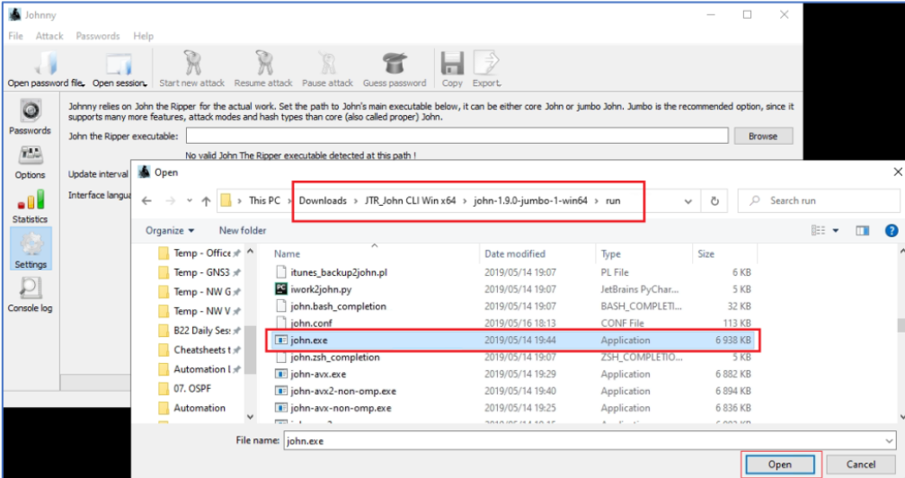
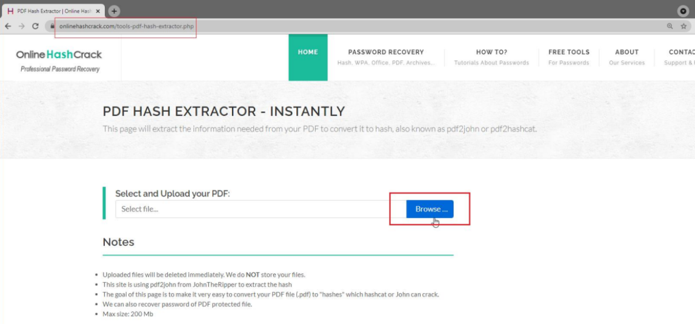
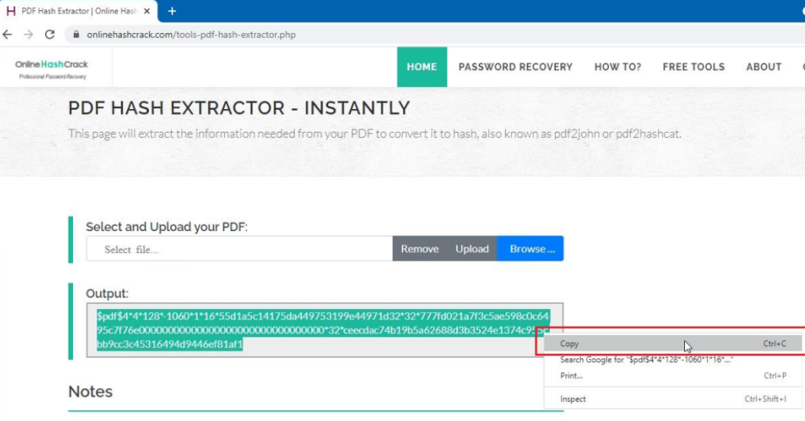
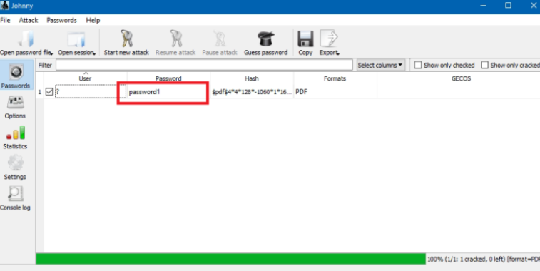
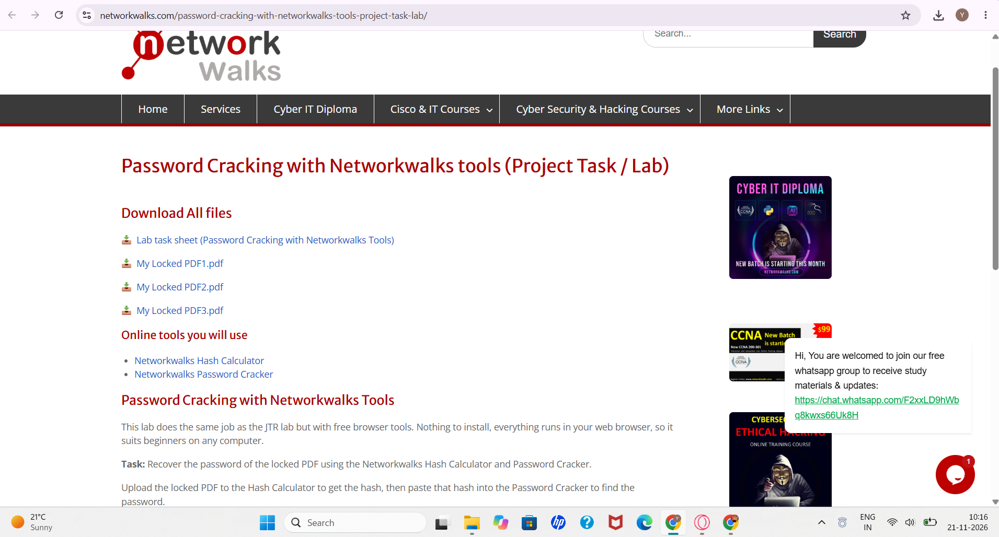

# Week_3-Password-cracked
This project focuses on understanding password security and password-cracking techniques using Python. It demonstrates how weak passwords can be vulnerable to cyberattacks and explains different techniques used in ethical hacking and cybersecurity.

# 🔐 Password Cracking

## 📌 Introduction

Password cracking is a technique used in cybersecurity to recover or identify passwords by testing different possible combinations of characters, words, or password hashes. It is commonly used by ethical hackers and cybersecurity professionals to evaluate password strength and identify security vulnerabilities.

This project demonstrates basic password-cracking techniques such as Brute Force Attack, Dictionary Attack, and Password Hash Analysis using Python.

The main objective of this project is to understand how weak passwords can be compromised and how to improve password security. It also provides practical knowledge of ethical hacking, password protection, and authentication mechanisms.

## 🎯 Objectives

- To understand the concept of password cracking.
- To study different password-cracking techniques.
- To demonstrate brute-force and dictionary attacks.
- To understand password hashing.
- To identify weak passwords.
- To learn password security and protection techniques.

## 🛠️ Technologies Used

- Python
- VS Code
- GitHub

## ⚡ Features

- Password strength checking.
- Password hash generation.
- Dictionary attack demonstration.
- Brute-force attack demonstration.
- Password security recommendations.

## 📚 Applications

- Cybersecurity education.
- Ethical hacking practice.
- Password security testing.
- Understanding authentication vulnerabilities.

This project is developed strictly for educational purposes and ethical cybersecurity learning. Use it only in authorized and controlled environments.

## Project 1
Password Cracking With JTR
## Step 1:-
Download John the Ripper After installation, open Johnny

## Step 2
Select John.exe:

## Step 3
Open the hash website & upload your pdf file to find its hash:

## Step 4
Select & copy the hash value:

## Step 5
Browse to the hash1.txt file that you have just saved & click on Open:

## Project 2
password Cracking With Networkwalks 

## Step 1
Download the encrypted PDF file (My Locked PDF1.pdf) to your laptop from the lab page:
https://networkwalks.com/project-task-lab-password-cracking-with-networkwalks-tools/

## Step 2

## Step 3
Open the Networkwalks Hash Calculator in your web browser:

![image alt](
